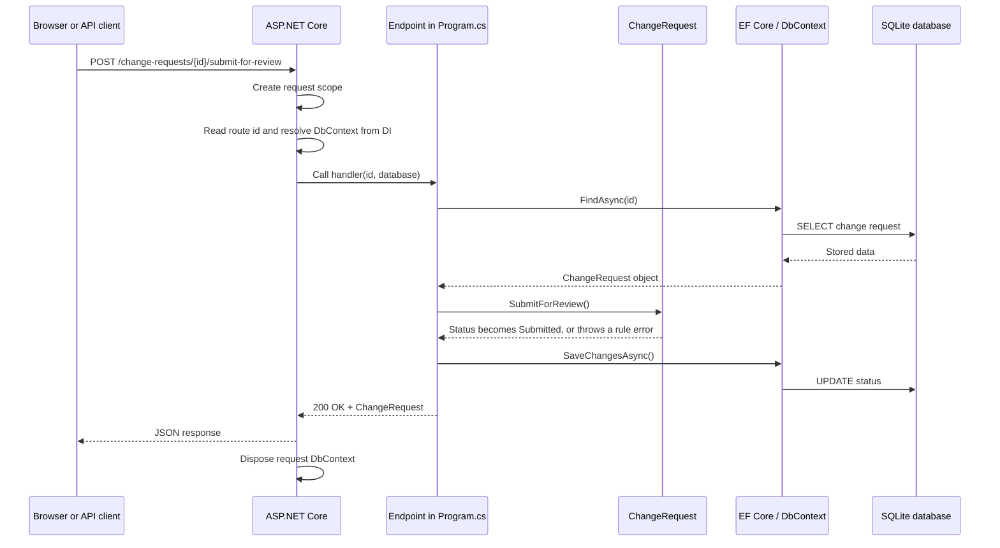
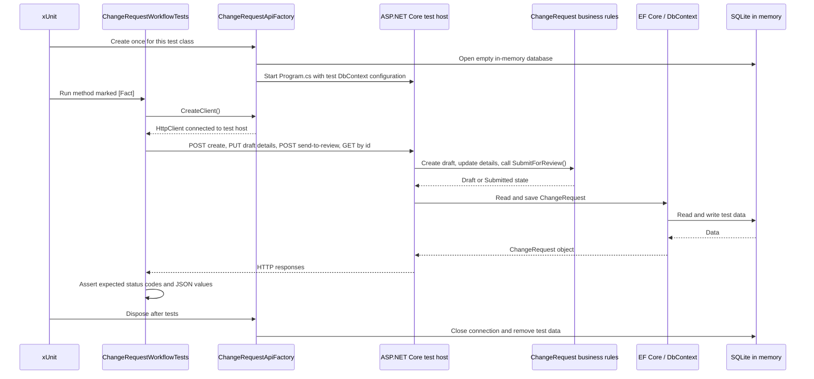
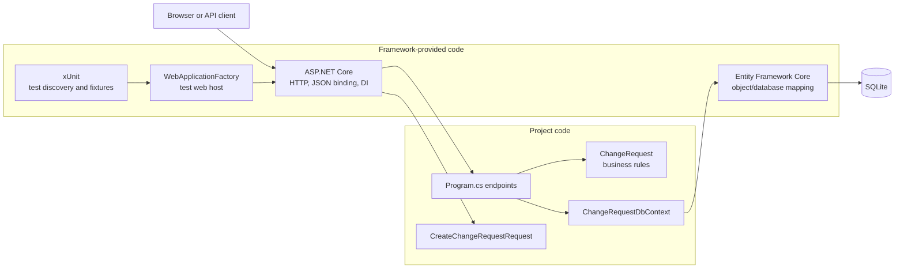

# Architecture diagrams

These diagrams show the responsibilities around the application. They deliberately show framework-provided work separately from project code.

## 1. A normal API request

For this endpoint, the client sends only the URL and HTTP method; it does not send a JSON body or a `DbContext`. ASP.NET Core creates the `DbContext` from its dependency-injection registration for this request.

## 2. An acceptance test

The acceptance test uses the same endpoints and domain rules as the real application, but it does not start a visible server and does not touch the local `change-requests.db` file.

## 3. Responsibility map

`ChangeRequest` owns workflow rules. `Program.cs` coordinates HTTP requests with the domain and persistence. ASP.NET Core supplies HTTP, JSON binding, and dependency injection; EF Core supplies database mapping; xUnit and `WebApplicationFactory` exist only for tests.
