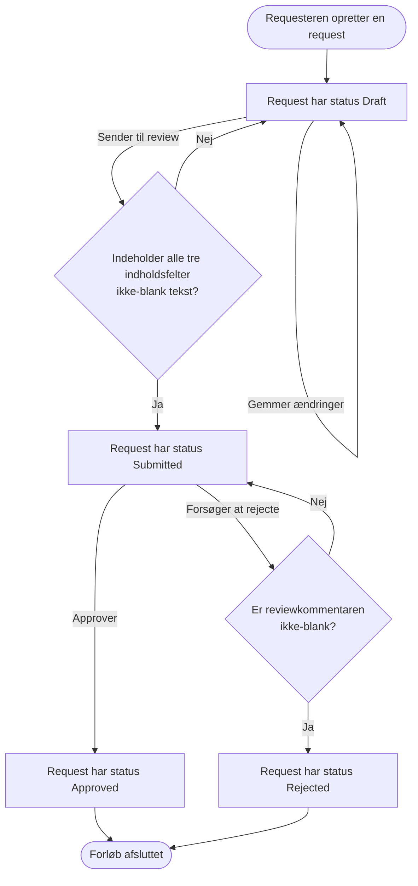

# Brugerrejser og forretningsflow

## Formål

Dette dokument beskriver de konkrete forløb, en requester og en reviewer gennemfører. Det omsætter kravene og reglerne i `03-requirements-and-business-rules.md` til observerbare handlinger, beslutninger og resultater.

En brugerrejse beskriver **hvad** der skal ske. Den beskriver endnu ikke HTTP-endpoints, klasser eller databasekald; de kommer i de efterfølgende dokumenter.

## Roller

| Rolle | Kan gøre i denne version |
|---|---|
| Requester | Oprette, se, redigere og sende en draft til review. |
| Reviewer | Se en submitted request og approve eller rejecte den. |

Rollerne er begreber i forløbet. Systemet har i denne version ikke login, brugeridentiteter eller adgangskontrol. Det er derfor muligt, at den samme person demonstrerer begge roller i browseren.

## Oversigt over livsforløbet



De eneste gyldige statusovergange er:

```text
Draft     → Submitted
Submitted → Approved
Submitted → Rejected
```

Pilene tilbage til `Draft` og `Submitted` i diagrammet er ikke statusovergange. De viser en afvist handling, hvor systemet bevarer den eksisterende status. At en bruger blot lader være med at udføre en handling, vises ikke i diagrammet.

## UJ-01: Opret og gem en draft

**Mål:** Requesteren påbegynder en change request, også selv om indholdet endnu ikke er klar.

| Trin | Aktør | Handling eller beslutning | Systemets resultat | Regler |
|---|---|---|---|---|
| 1 | Requester | Åbner oversigten. | Systemet viser eksisterende requests og en formular til en ny draft. | FR-02 |
| 2 | Requester | Indtaster nul, ét eller flere af indholdsfelterne. | Formularen kan indeholde delvist indhold. | BR-04 |
| 3 | Requester | Vælger at oprette/gemme draften. | Systemet opretter requesten med `Id`, `CreatedAt` og status `Draft`. | FR-01, BR-01, BR-02 |
| 4 | Requester | Åbner requesten senere. | Systemet viser dens gemte indhold og status `Draft`. | FR-03 |

## UJ-02: Rediger en draft

**Mål:** Requesteren gør en eksisterende draft klar til review.

| Trin | Aktør | Handling eller beslutning | Systemets resultat | Regler |
|---|---|---|---|---|
| 1 | Requester | Åbner en request med status `Draft`. | Systemet viser indholdsfelterne som redigerbare. | FR-03, BR-03 |
| 2 | Requester | Ændrer Title, Description og/eller Technical impact. | Ændringerne er endnu kun i browserens formular. | — |
| 3 | Requester | Gemmer ændringerne. | Systemet erstatter de tre gemte indholdsfelter. Status forbliver `Draft`. | FR-04, BR-03 |
| 4 | Requester | Forsøger at redigere en request, der ikke er draft. | Systemet afviser ændringen og bevarer eksisterende data. Brugerfladen tilbyder normalt ikke redigering i denne situation. | BR-03, BR-10 |

## UJ-03: Send en draft til review

**Mål:** Requesteren markerer, at change requesten er klar til en reviewers vurdering.

| Trin | Aktør | Handling eller beslutning | Systemets resultat | Regler |
|---|---|---|---|---|
| 1 | Requester | Åbner en request med status `Draft`. | Systemet viser muligheden for at sende til review. | FR-05, BR-05 |
| 2 | Requester | Ændrer eventuelt indholdsfelterne og vælger “Send til review”. | Browseren gemmer først de aktuelle tre felter på draften. Status er fortsat `Draft`. | FR-04, BR-03 |
| 3 | Systemet | Undersøger den nu gemte drafts Title, Description og Technical impact. | Submit-handlingen bruger ikke formularens værdier direkte, men de værdier, der netop er gemt på draften. | BR-06 |
| 4a | Systemet | Mindst ét felt mangler eller består kun af whitespace. | Handlingen afvises med fejlbesked. De aktuelle felter forbliver gemt på en `Draft`. | BR-06 |
| 4b | Systemet | Alle tre felter indeholder ikke-blank tekst. | Status ændres til `Submitted`. | FR-05, BR-05, BR-06 |
| 5 | Requester | Forsøger at sende igen efter den er submitted. | Handlingen afvises; status forbliver `Submitted`. | BR-05 |

## UJ-04: Approve en submitted request

**Mål:** Revieweren godkender den foreslåede ændring.

| Trin | Aktør | Handling eller beslutning | Systemets resultat | Regler |
|---|---|---|---|---|
| 1 | Reviewer | Åbner en request med status `Submitted`. | Systemet viser reviewmulighederne. | FR-03, BR-07 |
| 2 | Reviewer | Tilføjer eventuelt en kommentar og vælger approve. | Systemet gemmer kommentaren, hvis den findes. | BR-08 |
| 3 | Systemet | Gennemfører approve. | Status ændres til `Approved`, og `ReviewedAt` sættes til tidspunktet i UTC. | FR-06, BR-08 |
| 4 | Reviewer | Ser den godkendte request. | Resultatet er læsbart; ingen yderligere workflowhandling tilbydes. | BR-10 |

## UJ-05: Reject en submitted request

**Mål:** Revieweren afviser den foreslåede ændring og forklarer hvorfor.

| Trin | Aktør | Handling eller beslutning | Systemets resultat | Regler |
|---|---|---|---|---|
| 1 | Reviewer | Åbner en request med status `Submitted`. | Systemet viser reviewmulighederne, herunder felt til begrundelse. | FR-03, BR-07 |
| 2 | Reviewer | Indtaster en begrundelse og vælger reject. | Systemet undersøger, om begrundelsen er ikke-blank tekst. | BR-09 |
| 3a | Systemet | Begrundelsen mangler eller består kun af whitespace. | Handlingen afvises med fejlbesked. Status forbliver `Submitted`; `ReviewedAt` sættes ikke. | BR-09 |
| 3b | Systemet | Begrundelsen er gyldig. | Status ændres til `Rejected`; begrundelse og `ReviewedAt` gemmes. | FR-07, BR-09 |
| 4 | Reviewer | Ser den afviste request. | Resultatet og begrundelsen er læsbare; ingen yderligere workflowhandling tilbydes. | BR-10 |

## Brugerfladens beslutninger

Brugerfladen skal føre brugeren mod gyldige handlinger, men serveren håndhæver stadig alle regler.

| Requestens status | Rediger indhold | Send til review | Approve/reject | Vis resultat |
|---|---:|---:|---:|---:|
| `Draft` | Ja | Ja | Nej | Status og indhold |
| `Submitted` | Nej | Nej | Ja | Status og indhold |
| `Approved` | Nej | Nej | Nej | Status, indhold og eventuel reviewkommentar |
| `Rejected` | Nej | Nej | Nej | Status, indhold og reviewkommentar |

At browseren skjuler en handling er en hjælp til brugeren, ikke en sikkerheds- eller regelmekanisme. En klient kan stadig forsøge et HTTP-kald direkte; serveren skal i så fald afvise det efter forretningsreglerne.

## Afgrænsninger i forløbene

- En rejected request kan ikke rettes og sendes igen i denne version. Det ville kræve en bevidst ny statusovergang, for eksempel `Rejected → Draft`.
- En approved request udløser ikke implementering, ticket-oprettelse eller integration med Git/Azure DevOps.
- Hvem der udfører handlingerne registreres ikke. Derfor beskriver rollerne ansvar i forløbet, ikke teknisk adgangskontrol.
