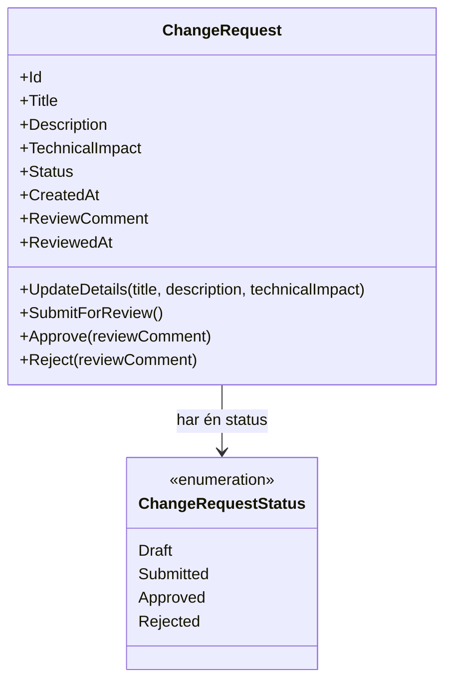
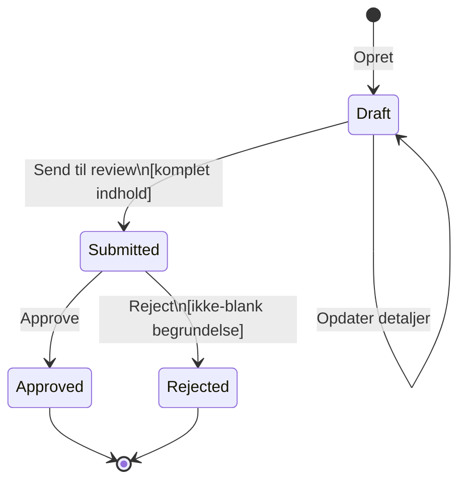

# Status- og domænemodel

## Formål

Dette dokument fastlægger den centrale model i systemet: én `ChangeRequest`, dens data, dens status og de handlinger, som må ændre den.

En **domænemodel** er her ikke et ekstra teknisk lag. Det er den kodeenhed, der repræsenterer selve forretningsbegrebet “change request” og beskytter reglerne om dens livsforløb.

## Centralt begreb

Systemet har én central type:

```text
ChangeRequest
```

`ChangeRequest` er navnet på en C#-klasse. Når programmet opretter eller læser én konkret request, arbejder det med et objekt — en konkret instans — af denne klasse. Objektet indeholder netop denne requests data og kan udføre dens tilladte handlinger.

En `ChangeRequest` er forretningsmæssigt et forslag til en teknisk ændring, som først kan vurderes, når den er beskrevet tilstrækkeligt. Den er ikke en Git pull request, en kodeændring eller en implementeringsopgave.

## Klassediagram



Et **klassediagram** viser den statiske form: hvilke data og metoder en klasse har, og dens relation til andre typer. Det viser ikke rækkefølgen, hvori metoder kaldes; det er sekvens- og flowdiagrammers opgave.

## Statusmodel



Diagrammet er et **tilstandsdiagram**. I modsætning til flowdiagrammet i det foregående dokument viser det kun:

1. statusserne
2. gyldige overgange mellem dem
3. handlingen og eventuelle betingelser på hver overgang

Det viser ikke skærmbilleder, browseradfærd eller HTTP-kald.

## Statusser og deres betydning

| Status | Betydning | Tilladte næste handlinger |
|---|---|---|
| `Draft` | Requesten er under udarbejdelse. Indholdet må være ufuldstændigt. | Opdater detaljer; send til review, hvis indholdet er komplet. |
| `Submitted` | Requesten er klar til review og må ikke længere ændres af requesteren. | Approve; reject. |
| `Approved` | Reviewet har godkendt requesten. | Ingen. Requesten er final. |
| `Rejected` | Reviewet har afvist requesten med en begrundelse. | Ingen. Requesten er final. |

## Data på en ChangeRequest

| Felt | Type/format | Sættes af | Må ændres | Formål |
|---|---|---|---|---|
| `Id` | Globalt unikt id | Systemet ved oprettelse | Nej | Identificerer én bestemt request. |
| `Title` | Tekst | Requesteren | Kun ved `Draft` | Kort navn på ændringsforslaget. |
| `Description` | Tekst | Requesteren | Kun ved `Draft` | Beskrivelse af den foreslåede ændring. |
| `TechnicalImpact` | Tekst | Requesteren | Kun ved `Draft` | Teknisk konsekvens eller vurdering. |
| `Status` | En af de fire definerede statusser | Systemet gennem handlinger | Kun gennem gyldig overgang | Styrer, hvilke handlinger der er gyldige. |
| `CreatedAt` | UTC-tidspunkt | Systemet ved oprettelse | Nej | Viser, hvornår requesten blev oprettet. |
| `ReviewComment` | Tekst eller fraværende | Revieweren | Kun ved afsluttende review | Gemmer valgfri approve-kommentar eller obligatorisk reject-begrundelse. |
| `ReviewedAt` | UTC-tidspunkt eller fraværende | Systemet ved afsluttende review | Nej efter den er sat | Viser, hvornår reviewet blev afsluttet. |

## Handlinger, ejerskab og kontroller

| Handling | Forudsætning | Data der ændres | Kontrol, der skal udføres af ChangeRequest |
|---|---|---|---|
| Opret | Ingen | `Id`, `CreatedAt`, `Status`; indhold kan sættes tomt eller delvist | Tildel ny identitet, UTC-tidspunkt og `Draft`. |
| Opdater detaljer | Status er `Draft` | `Title`, `Description`, `TechnicalImpact` | Afvis ved enhver anden status. |
| Send til review | Status er `Draft` | `Status` | Afvis, hvis et af de tre indholdsfelter er `null`, tomt eller kun whitespace; sæt ellers status til `Submitted`. |
| Approve | Status er `Submitted` | `Status`, `ReviewComment`, `ReviewedAt` | Afvis ved anden status; sæt status til `Approved` og reviewtidspunkt til UTC. |
| Reject | Status er `Submitted` | `Status`, `ReviewComment`, `ReviewedAt` | Afvis ved anden status eller blank begrundelse; sæt status til `Rejected` og reviewtidspunkt til UTC. |

Disse kontroller ligger i `ChangeRequest`, ikke kun i browseren eller i HTTP-endpoints. Det betyder, at reglerne gælder, uanset om handlingen startes fra den nuværende TypeScript-brugerflade, en senere anden klient eller en automatiseret test.

## Foreslået offentlig overflade

Den konkrete C#-syntaks kan variere, men modellen skal give resten af programmet en lille, tydelig offentlig overflade:

```text
ChangeRequest
  UpdateDetails(title, description, technicalImpact)
  SubmitForReview()
  Approve(reviewComment)
  Reject(reviewComment)
```

Felterne må læses af de dele af programmet, der skal vise eller gemme dem. De bør ikke kunne sættes frit udefra, fordi det ville gøre det muligt at springe statusreglerne over.

Handlingerne er kommandoer: ved en gyldig handling ændrer de objektets egen tilstand og giver derefter kontrollen tilbage til den kaldende kode. De behøver ikke returnere et særskilt resultatobjekt. Ved en ugyldig handling signalerer de en fejl, og endpointet omsætter den til et HTTP-fejlsvar.

Navnet `SubmitForReview()` angiver handlingens betydning. Den faktiske domænemetode og API-endpointet `/submit-for-review` bruger dette fulde navn konsekvent.

## Ugyldige overgange

Følgende må ikke kunne ske:

| Forsøg | Hvorfor ugyldigt |
|---|---|
| Opdatere `Submitted`, `Approved` eller `Rejected` | Kun `Draft` er redigerbar. |
| Sende `Submitted`, `Approved` eller `Rejected` til review | Kun en `Draft` kan sendes til review. |
| Approve eller rejecte en `Draft` | Den er ikke sendt til review. |
| Approve eller rejecte en final request | Reviewet er allerede afsluttet. |
| Rejecte uden begrundelse | Et afslag skal kunne forklares. |
| Sætte `Status` direkte til en vilkårlig værdi | Status ændres kun af en gyldig handling. |

## Bevidst udeladt fra modellen

- Requester- og revieweridentitet.
- Historik over flere reviews eller tidligere statusser.
- Genåbning eller ny indsendelse efter reject.
- Sletning.
- Validering af, om den tekniske vurdering er fagligt korrekt. Det er reviewets menneskelige opgave.
