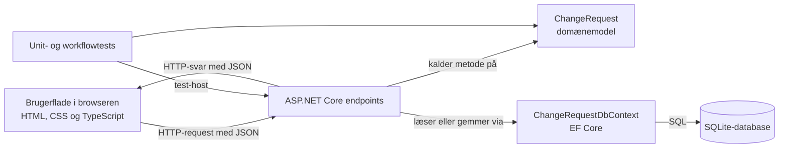

# Arkitektur og tekniske beslutninger

## Formål

Dette dokument beskriver den planlagte opdeling af programmet og de tekniske beslutninger, som har konsekvenser for implementering, test eller vedligeholdelse.

Det beskriver konkrete ansvar. Det er ikke en liste over teknologier, der kunne have været brugt.

## Systemets dele



Diagrammet viser, hvilke dele der kalder eller bruger hinanden under en normal HTTP-handling. Returveje er bevidst ikke tegnet: de gør dette overblik utydeligt. Et senere sekvensdiagram kan vise dem, hvis de er vigtige for at forklare et konkret kald.

Ikke hvert endpoint følger alle pile. En læsehandling bruger eksempelvis `DbContext`, men kalder normalt ikke en ændrende metode på et `ChangeRequest`-objekt.

## Ansvar pr. del

| Del | Ansvar | Må ikke være ansvarlig for |
|---|---|---|
| Brugerflade i browseren | Vise data, indsamle brugerinput, kalde API’et og vise svar eller fejl. | At være eneste sted, hvor forretningsregler håndhæves. |
| API-endpoint | Modtage HTTP-kald, oversætte JSON til et request-objekt, finde eller gemme data, kalde domænemodellen og omsætte resultat til HTTP-svar. | At indeholde reglerne for, hvilke statusovergange der er gyldige. |
| `ChangeRequest` | Repræsentere én request og håndhæve dens regler om indhold, status og review. | At kende HTTP, JSON, EF Core, SQLite eller browseren. |
| `ChangeRequestDbContext` | Give EF Core en model af de data, der skal læses og gemmes. | At beslutte, om en statusovergang er lovlig. |
| SQLite | Opbevare data lokalt i én databasefil. | At fortolke forretningsregler. |
| Tests | Dokumentere og kontrollere den aftalte adfærd. | At erstatte den menneskeligt læsbare specifikation. |

## Planlagt struktur i projektet

```text
src/ChangeRequestApproval.Web/
  Api/                 HTTP-request- og response-typer
  Domain/              ChangeRequest og ChangeRequestStatus
  Persistence/         ChangeRequestDbContext
  Frontend/            TypeScript-kildekode
  wwwroot/             Færdigbyggede browserfiler
  Program.cs           Samler appens dele og registrerer endpoints

tests/ChangeRequestApproval.Tests/
  Infrastructure/      Test-host og testdatabaseopsætning
  ...Tests.cs          Unit- og workflowtests
```

Mappestrukturen er kun værdifuld, hvis den gør det hurtigere at finde ansvar. Derfor bruges få, navngivne områder frem for et generisk lag for enhver mulig type kode.

## TD-01: Én ASP.NET Core-applikation

**Beslutning:** Vores HTML-, CSS- og JavaScript-filer samt HTTP-endpoints og backend udgives fra én deployable ASP.NET Core-applikation.

**Begrundelse:** Der er én lille brugerflade, ét afgrænset workflow og ingen kendt uafhængig drift eller skalering af delene. Én applikation gør opstart, lokal udvikling og fejlfinding enkel.

**Konsekvens:** Når vi udgiver en ny version, udgives brugerfladefilerne og backend-koden i samme release. En anden klient, for eksempel en separat webapp eller mobilapp, kan senere kalde de samme HTTP-endpoints, så længe den følger API-kontrakten.

## TD-02: Domæneregler ejes af ChangeRequest

**Beslutning:** `ChangeRequest` udfører validering og statusovergange gennem navngivne metoder som `SubmitForReview`, `Approve` og `Reject`.

**Begrundelse:** Reglerne er egenskaber ved en change request, ikke ved en bestemt skærm eller URL. Ét sted reducerer risikoen for, at forskellige endpoints eller klienter håndhæver regler forskelligt.

**Konsekvens:** API’et kalder en domænemetode frem for selv at sætte `Status`.

## TD-03: EF Core og SQLite til lagring

**Beslutning:** Programmet bruger EF Core med SQLite.

**Begrundelse:** SQLite giver reel permanent lokal lagring uden en separat databaseserver. EF Core gør læsning og lagring af `ChangeRequest` tydelig i C# og kan erstattes eller omkonfigureres senere, hvis en anden database kræves.

**Konsekvens:** Databasefilen er lokal kørselsdata og skal ikke committes til Git. Testene bruger en separat in-memory SQLite-database, så de ikke læser eller ændrer udviklerens fil.

## TD-04: Ingen repository-lag oven på DbContext

**Beslutning:** Endpoints bruger `ChangeRequestDbContext` direkte til denne app i stedet for et ekstra repository-interface og -implementering.

**Begrundelse:** Appen har få, enkle forespørgsler. Et repository ville i denne situation mest videresende kald til EF Core uden at samle selvstændig logik eller give en bedre testgrænse.

**Konsekvens:** Hvis dataadgang senere bliver kompleks eller deles af flere use cases, kan behovet vurderes igen på baggrund af konkret duplikation eller kompleksitet.

## TD-05: Lille TypeScript-brugerflade uden frontend-framework

**Beslutning:** Brugerfladen skrives i TypeScript med browserens almindelige DOM-API’er, HTML og CSS.

**Begrundelse:** Skærmene har få tilstande og ingen kompleks komponentstruktur. TypeScript giver typekontrol for API-data uden omkostningen ved at indføre et framework og dets mønstre.

**Konsekvens:** UI-koden skal holdes opdelt i små navngivne funktioner, så direkte DOM-kode forbliver læsbar. Hvis antallet af skærme eller delt UI-logik vokser væsentligt, skal valget vurderes igen.

## TD-06: To testniveauer

**Beslutning:** Vigtige regler testes både som unit-tests af `ChangeRequest` og som workflowtests gennem HTTP-API’et.

**Begrundelse:** Unit-tests gør hver regel hurtig og præcis at kontrollere. Workflowtests kontrollerer samspillet mellem endpoint, JSON, domænemodel og database.

**Konsekvens:** Det samme væsentlige forløb kan godt være repræsenteret på begge niveauer, men testene skal have forskellige formål og ikke kopiere alle detaljer ukritisk.

## Teknisk ansvarskæde ved en ændring

Når en bruger sender en draft til review, er den planlagte kæde:

```text
Browser
  → API-endpoint
    → læser ChangeRequest fra DbContext
      → kalder ChangeRequest.SubmitForReview()
        → ChangeRequest accepterer eller afviser reglen
      → DbContext gemmer den eventuelle ændring
    → endpoint sender HTTP-svar
  → browseren viser resultat eller fejl
```

Denne kæde er et vigtigt reviewpunkt: Et endpoint må koordinere handlingen, men må ikke selv blive stedet, hvor den grundlæggende statusregel afgøres.
